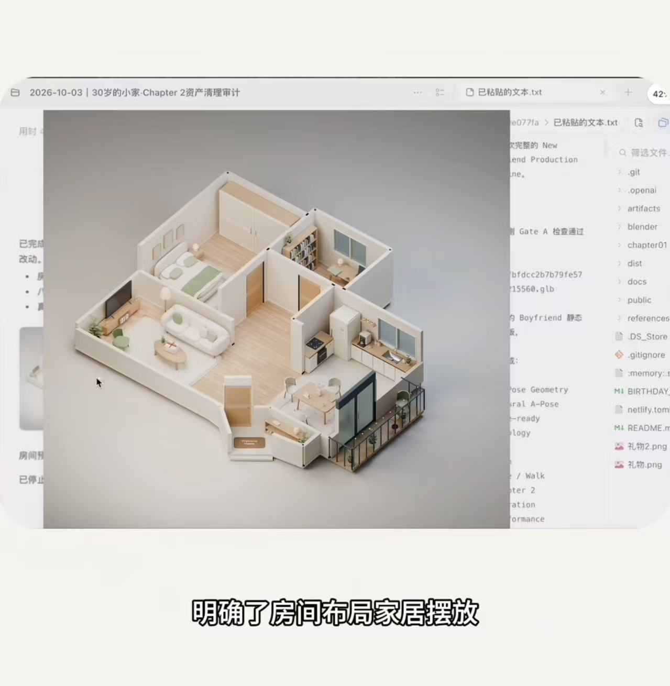

# 3D 小屋第二阶段：成品场景制作

用户于 2026-10-18 批准本方案。目标是将 7 个可见区域升级为可展示、可游玩的精致微缩小屋；原阶段6个区域可达；2026-10-29按[美食Close-up方案](food-collection/close-up-interaction.md)追加厨房开放通行与左侧台面互动，目标更新为7个可见区域可达，其他房间关闭。厨房通行改造尚待实施。交付房屋、完整通用卡通角色和 5 个坐位。V1 的 7 个彩蛋、私人阅读内容、专属人物及生日演出在本阶段之后实现。

## 制作与对齐

按“制作基准 → 餐厅成品样板 → 全屋生产 → 展示验收”推进。目标板确定色彩、材质、角色和尺度；实际引擎样板确定光照、镜头、动作和游玩品质；合格资产进入全屋。最终视觉验收以浏览器为准。

- 美术：精致微缩小屋，柔和暖光，白色表面有层次，家具接地，轮廓与倒角经过设计，生活细节适量。照片保留房间关系和家的识别性，比例服务于画面与操作。
- 镜头：向下 40°、透视 FOV 35°，以角色为观察点平缓跟随，鼠标相对移动量控制水平环绕，停手即停，有限缩放；跨区域连续取景，坐姿独立近景。走近对齐后按 [固定场景转场](fixed-scene-transition.md)短淡化切入预设机位，画面显现后才坐下。墙体、顶面和高柜遮挡单独管理，隐藏不改变碰撞。2026-10-25 基础控制合同见 [相对鼠标游览与分层 Esc](mouse-look.md)，实际验证状态见 [HOUSE](../status.md)。
- 尺度：完整通用卡通人物约 1.65 m、5.5 头身；椅面 0.45 m、椅背总高 0.85–0.95 m；桌面 0.74–0.76 m；沙发与软墩座面 0.42–0.45 m；双门冰箱 1.85–1.95 m；通道净宽至少约 0.9 m。均为项目设计基准，非实测。
- 动作：Idle、Walk、SitDown、SitIdle、StandUp 五种骨骼动画；角色不依座位改变体型。五坐位为长沙发中部、窗边、入口软墩、餐椅、书房椅。F 接近对齐、转身、坐下；Esc 起身并在坐位旁恢复探索。臀部贴合座面、脚有支撑、腿与手臂不穿家具。
- 操作：WASD 和方向键；动作切换隔离输入；移动速度匹配步态，提示简洁。

## 美术目标板与资产取舍

用户提供的参考图用于目标观感，不作为房屋布局来源。重点是完整构图、柔和接触明暗、清楚的布木石金属区别、精心处理的轮廓与适量生活细节。本站实际照片仍决定家具识别性与房间关系。

| 内容 | 制作决定 | 理由 |
| --- | --- | --- |
| 房间邻接、照片和空间分级 | 保留 | 维持家的辨识度与已选范围 |
| 通用人物、动作、座位定位 | 重做 | 正式骨骼与身体尺度统一，替换原型拼装与身体缩放 |
| 餐桌椅、冰箱、书桌椅 | 重建结构并校准尺寸 | 桌下空间、坐面与握持高度必须与人物成立 |
| 沙发、柜体、建筑和主要陈设 | 改造轮廓、尺度、材质与细节 | 保留识别性，达到同一精度 |
| 灯光、镜头、遮挡 | 重新设计 | 网页实景的层次与完整构图是验收目标 |
| 原始私人资料与后续彩蛋 | 保留原位置 | 本阶段不进入内容实现或公开发布 |

首版角色采用深棕发、柔蓝绿外套、奶油长裤和浅棕鞋，与暖白墙、木色、柔绿点缀协调。完整人物先用于尺度与动作，本阶段不制作私人肖像。

## 资产与运行

保留房间邻接、照片依据及有效构建能力；重做人物/动画/坐位系统，重整家具尺度、材质、灯光和镜头。明显不合格的几何体直接重建。Blender 可使用网格编辑、倒角、曲面、UV、贴图和骨骼，脚本保证可复现而非限制品质。

每类资产有唯一权威来源。脚本生成资产由脚本维护，独立制作的源 .blend 不被共享构建清空。人物与房屋分别导出 GLB，保留角色骨骼动画。继续 Blender + Godot/GDScript/Compatibility/Web。

静态环境采用预计算光照，动态人物使用光照探针与受控实时阴影；先验证网页兼容性。可隐藏墙体、固定物件及活动部件分别处理，避免残留悬空阴影。运行时加载制作好的资产。

家具提供稳定 ID、碰撞；冰箱门为独立铰接对象。坐位从资产输出接近点、坐姿根定位、退出点和镜头，运行时读取。为后续道具预留展示与接近空间。本阶段不实现故事事件。

## 分工与版本

Builder 和独立 reviewer 均使用 gpt-6-astra / medium；派发回执核对实际模型，后续小模型由用户单独指定。主控负责整体美术、公共合同、集成、最终浏览器验收。先公共尺度/角色/材质，再按区域执行。共享整屋构建、烘焙、导出串行执行。

旧原型的精度、无投影、旧机位及固定家具比例退出当前标准。历史验收仅用于追溯。其他会话更改保留。

## 里程碑与验收

1. 制作基准：规则与配置、目标板、比例图、全屋布置图和资产取舍。
2. 餐厅样板：正式角色、桌椅、冰箱、柜体、材质、灯光、镜头、行走坐起，在网页达到目标品质后固定生产标准。
3. 全屋：其余 6 区统一升级、5 坐位、跨区域镜头与通路。
4. 展示验收：7 区截图，餐厅/客厅/书房近景，源资产与网页一致，实机演示。

每个坐位至少 3 次坐起，覆盖不同接近方向与连续按键。验证七区通行及关闭空间边界（厨房按新增Close-up范围实施后验收）、连续环绕、每 45°机位及缩放上下限；检查任意角度下的画面相对移动和跨房间跟随连续性。人物分别与门/冰箱/桌/椅同框核对比例。Chrome、1920×1080 与 1366×768，连续探索 10 分钟无错误、失控或明显累积卡顿；本开发机 1080p 以 25–30 FPS 为当前可接受水平（2026-10-25 用户确认），记录实际帧耗时，目标电脑另行实测。所有证据关联当前资源版本。

用户在制作基准、样板、全屋交付判断整体观感；日常实施决策由 agent 负责。样板不是本阶段终点。全屋完成后转入 V1，为 11 月 12 日交付保留内容与测试时间。原始私人素材本地只读，不公开部署。

## 实现状态

实际完成情况见[当前状态](../status.md)，原始执行记录保存在[场景 V2 历史快照](../archive/scene-v2-history.md)。下方保留制作规格与实施合同，不表示所有验收已经完成。

## 实施合同

- 公共尺度唯一来源：`../blender/scene-v2-spec.json`；房间 ID 保持 living/dining/study/hallway/balcony/wash/kitchen。旧 `house-layout.json` 的 bounds 数组接口保留。
- 房屋继续输出 `godot/assets/living-room.glb`；各 Mesh 的 extras 统一提供 room_id、collision、cutaway，家具附 furniture_id。避免以旧对象名称推断语义。
- 房屋另输出 `godot/assets/scene-v2-data.json`：version=2、seats 数组、furniture 数组、room_targets 字典。全部坐标已转换为 Godot 米制，位置数组 [x,y,z]，角度为弧度。
- seat 项：id、room_id、label、furniture_id、approach、root、exit、yaw、surface_height、camera_position、camera_target。root 是坐姿角色的脚底基准根点；yaw=0 角色面朝 Godot +Z，正 yaw 向 +X。五 ID 为 sofa_middle/window_seat/entry_stool/dining_chair/study_chair。坐面统一 0.45 m，角色 SitIdle 在 root.y=0 时臀部底面贴 0.45 m。
- furniture 项至少包括 id、room_id、kind、bounds_min、bounds_max。供比例与碰撞验收；碰撞由对应模型标记生成，桌下与坐位通道按真实用途处理。
- 角色独立输出 `godot/assets/character.glb` 与 `character-contract.json`；standing soles y=0、height=1.65、forward=+Z，五动画命名 Idle/Walk/SitDown/SitIdle/StandUp（允许 glTF 导入库前缀）。Idle/Walk/SitIdle 循环；其余单次；动画不修改角色整体缩放。根平移由 Godot 管理，Walk 为原地循环并输出参考行走速度。
- Blender 轴转换 (x,y,z)→Godot(x,z,-y)。角色在 Blender 中面朝 -Y。角色 builder 在独立 .blend 构建，不写房屋共享文件；房屋构建不覆盖角色。
- 运行时保留 snapshot() 和 query `?test` 的只读状态桥供实际按键验证，正常试玩不显示测试数据。

- 2026-10-25 用户确认性能当前达到 25–30 FPS 即可，取消稳定 60 FPS 要求；本次重新打开现有版本供用户试玩，不限帧、不改画质，原始性能报告保留。
