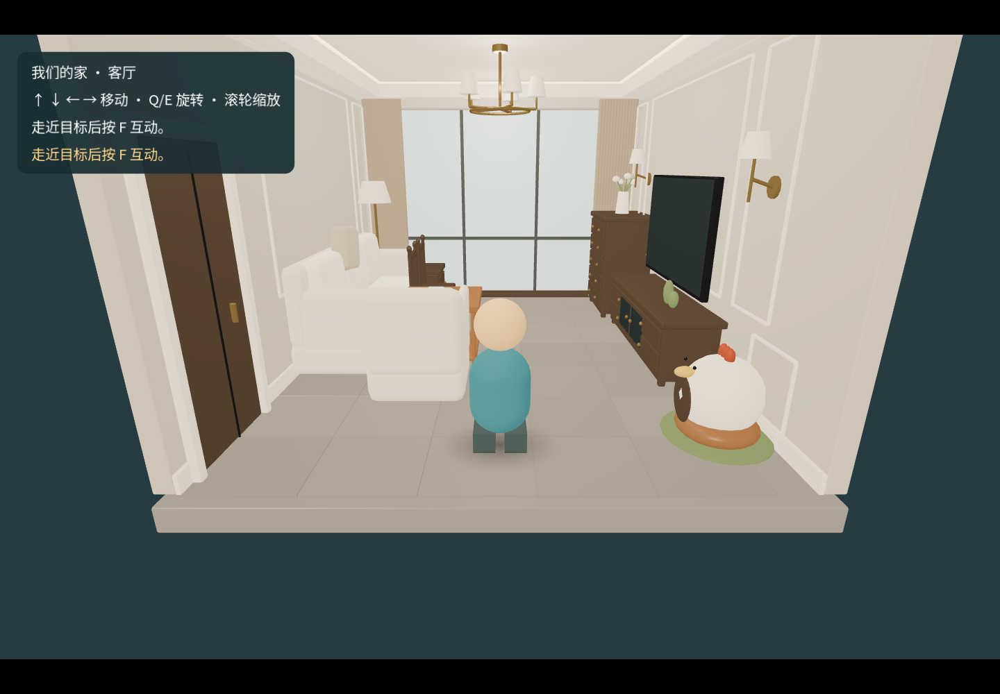
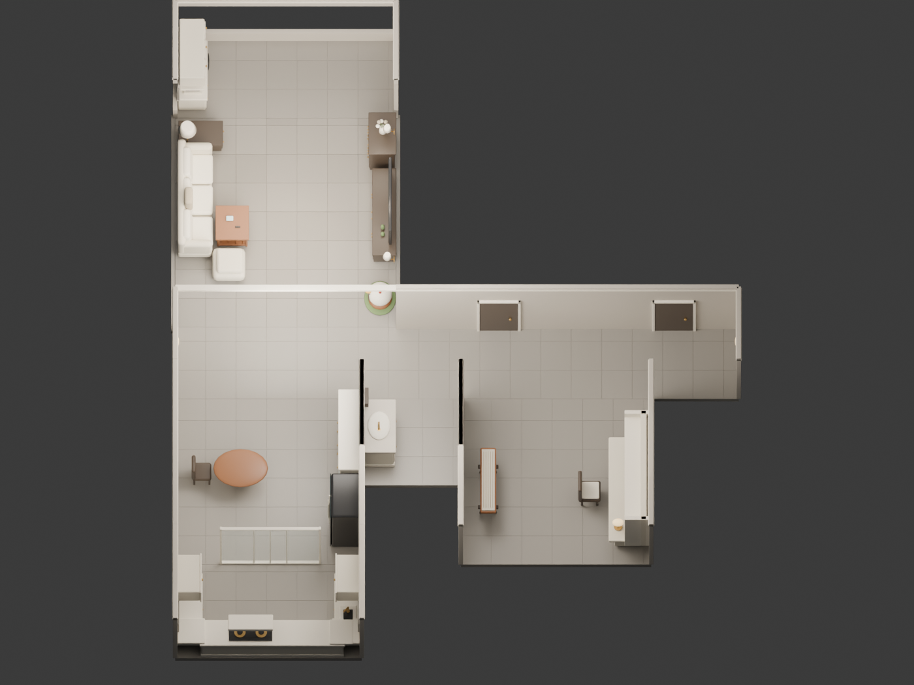
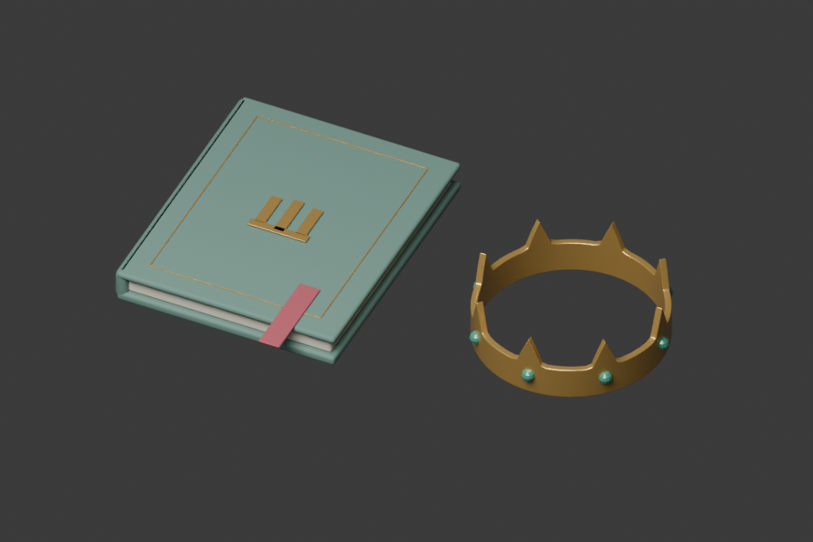
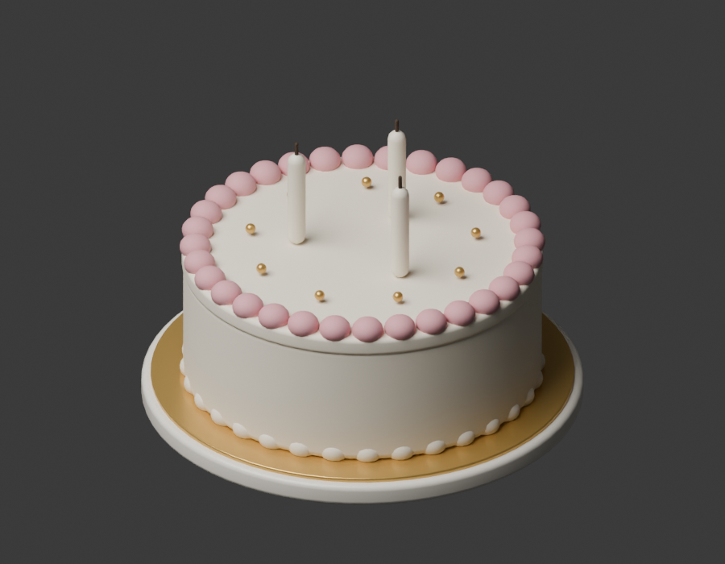
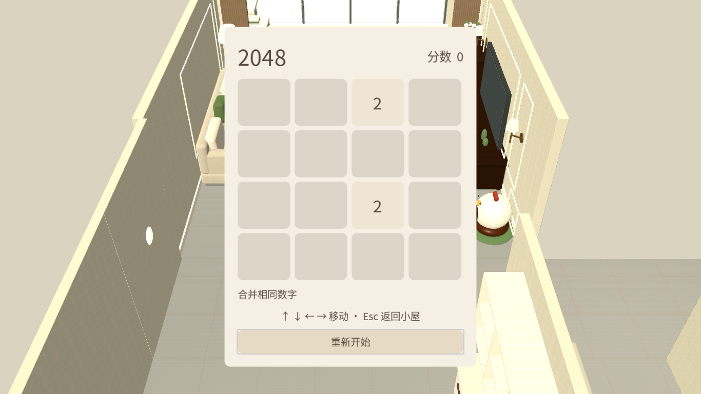
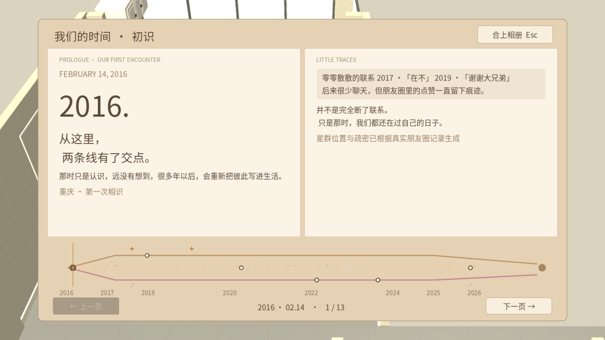
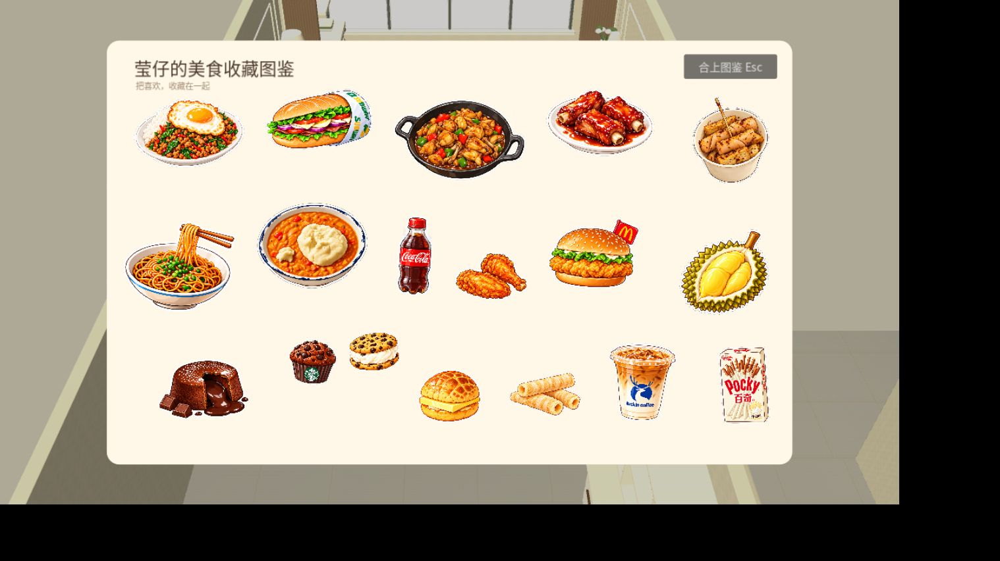

# 小屋成长记

一份生日礼物，也是一段慢慢造出一间小屋的过程。这份记录挑选值得记住的阶段，留下当时的画面和线索；以后有了新的故事，再往下接着写。

这里的日期是已找到的阶段记录或提交日期，不一定是创意第一次出现的日期。图片保留当时的版本，画册里的示意文字和日期仍以素材核实结果为准。当前游戏状态请看[项目状态](../status.md)。

## 故事的起点 · 想做一份可以走进去的礼物

**2026 年 10 月 15—16 日 · 最初的讨论**

想法是把熟悉的家做成一份生日礼物：她能在电脑浏览器里打开，自己走进去探索。你提供创意、照片和背景，制作交给 Agent；最初先做一个简单场景，看看这个想法能不能变成可玩的东西。

线索：Codex 会话《梳理 Blender 生日礼物项目方案》，ID `01a13ebd-7660-7351-8eed-d256eb63c75f`；[项目目标](../project.md)。

## 第一站 · 先从客厅开始

**2026 年 10 月 16 日 · 客厅原型与项目初始化**

一开始，整个世界还只有一间客厅。根据家里的照片，沙发、电视柜、窗帘和小小的鸡形宠物窝先有了位置；一个简化的小人已经可以在里面走动。那时的房间还很简单，但熟悉的轮廓已经出现了。

*早期客厅预览，原文件记录于 10 月 16 日；画面中的角色与操作提示都属于当时的版本。*

后来为了让空间更舒展，茶几缩小，部分家具被移走；10 月 17 日客厅进一步加宽，留下更多能走动的空间。

线索：[客厅建模记录](../archive/living-room.md) · Git `45aef74`、`52447bb` · 原图 `outputs/previews/living-space-start.png`。

## 第二站 · 从一个房间走到整个家

**2026 年 10 月 17—19 日 · 全屋粗版到场景 V2**

客厅之外，餐厅、书房、走道、阳台和洗漱区也逐渐连了起来。先有能看清空间关系的粗版，接着重新调整家具、人物比例和坐位，让小人可以在屋里走，也可以坐下来看看。

*10 月 17 日留存的全屋粗版俯视图，是模型预览，不是玩家游览画面。*

10 月 18 日记录了七个可见区域、正式比例的通用角色和五个坐位的集成；19 日又补做了实际操作检查。后来镜头和坐起方式还继续调整，屋子不是一下子变成现在的样子的。

线索：[项目阶段记录](../archive/project-history.md) · [全屋验收历史](../archive/house-history.md) · Git `53feb6a` 于 10 月 26 日同步该阶段成果 · 原图 `outputs/previews/whole-house-overview.png`。

## 第三站 · 把情书和王冠放进小屋

**2026 年 10 月 27 日 · 情书文集与王冠**

书房里有了一本可以打开的文集。翻阅到指定篇章时，可以领取王冠；戴上以后，也能取下再戴。原本只存在于文字里的东西，开始有了能在屋里拿起、阅读和佩戴的样子。

*书和王冠的资产预览，不是阅读界面截图。*

这一版收录了 15 篇非草稿正文和 7 张图片。10 月 27 日的记录里，你亲自试过后说“大致没问题”；当时仍保留了最终网页验收的证据缺口。

线索：[Stage 1 设计](../design/stage-1-letters-crown.md) · [状态记录](../status.md) · Git `3a379eb` · 原图 `outputs/previews/stage1-props.png`。

## 第四站 · 为生日准备一个蛋糕

**2026 年 10 月 27 日 · 蛋糕与生日仪式的本地候选**

蛋糕有了自己的位置和一套准备过程：从冰箱取出，摆到餐桌上，再点燃蜡烛。戴着王冠、准备好蛋糕后，玩家可以主动开始生日仪式。

*蛋糕资产的离线渲染；不是生日仪式的网页截图。*

蛋糕和仪式已经做出本地候选，但当时没有取得合格的仪式网页截图，完整玩家路径验收也还没有闭环。等以后补到真实画面，可以把它接在这张模型图后面。

线索：[蛋糕与仪式设计](../design/stage-2-cake-ceremony.md) · [状态记录](../status.md) · Git `3a379eb` · 原图 `outputs/previews/stage2-cake.png` · 本机验收记录 `work/stage2/acceptance.md`。

## 第五站 · 茶几上的手机能玩 2048 了

**2026 年 10 月 27 日 · 小游戏实现候选**

小屋里不只有回忆，也有可以随手玩的东西。茶几上放了一部手机，打开后可以玩 4×4 的 2048，同一次游玩里离开再回来还能保留棋局。

*引擎测试中直接打开的画面，不是自然走到手机后的网页验收截图。*

最初合并时整块面板会闪色；收到反馈后，效果改成了方块滑动、合并和新方块出现。规则和动画做过引擎检查，但当时最终候选的网页手感、自然进入与退出仍缺少证据。

线索：Codex 会话《2048 手机彩蛋：实现与独立验收》，ID `01a17d76-ef73-7763-a469-d94fd3d468fd` · [2048 设计](../design/c01-2048.md) · [状态记录](../status.md) · Git `646bf43` · 原图 `work/2048-engine-ui.png` · 本机记录 `work/2048-delivery.md`。

## 第六站 · 时间有了一本画册

**2026 年 10 月 28 日 · 时间画册首版**

客厅电视柜上多了一本相册。打开后，可以翻阅不同的记忆单元，也可以沿着时间轴来回选择。尚未准备好的照片和内容先留下位置，画册因此保留了继续生长的空间。

*10 月 28 日 Chrome 网页检查中的早期版本；画面中的日期和文字属于当时的示意内容，仍待核实。*

这一版在网页里走过了从客厅接近、打开相册、翻页和返回的路径。10 月 29 日时间轴又继续调整，出现了小舟、双股轨迹和暖光接力；真实照片及部分内容仍待补充，上图保留的是更早的一版。

线索：Codex 会话《开始 Stage 3 开发》，ID `01a18434-33c2-71d3-8afa-8ae1cf57b590` · [时间画册设计](../design/stage-3-e03-time-album.md) · [状态记录](../status.md) · Git `cbe72f6` · 原图 `work/stage3/1366-start.png` · 本机记录 `work/stage3/delivery.md`。

## 第七站 · 喜欢的食物变成收藏

**2026 年 10 月 29 日 · 美食图鉴与发现方式**

喜欢的食物慢慢聚到一张图鉴里：从逐项整理素材和排版，到一屏展示 18 款，再到能打开详情。图鉴后来不只是一本画册，食物也开始藏进小屋里的不同地方，等着走近发现。

*10 月 29 日 Chrome 检查中的图鉴总览，为当时用于检查的展示状态。*

后续的厨房通行、四处发现入口和收藏保存已有本地候选及网页路径检查；这份记录写下的是当时做到的阶段，后续调整仍以项目状态为准。

线索：Codex 会话《审阅并归档新增美食彩蛋》，ID `01a18869-4805-7093-8bdb-d2cd9f28ac62` · [美食图鉴设计](../design/food-collection/README.md) · [状态记录](../status.md) · Git `6655b07`、`058dc47` · 原图 `work/food-game-v2/final-board.png` · 本机记录 `work/food-game-v2/delivery.md`、`work/food-closeup/delivery.md`。厨房与发现机制是当时未提交的本地成果，不包含在上述提交中。

## 图片与证据还缺什么

- 七站各有一张当时留存的画面：客厅与全屋是早期预览，情书、王冠和蛋糕是资产图，2048 是引擎测试图，画册与图鉴是浏览器检查图。它们各自证明的范围不同。
- 情书阅读、完整生日仪式和 2048 自然进入的历史网页截图本轮尚未找到；尤其生日仪式与 2048 的当时验收记录明确保留网页证据缺口。找到新材料后再补，不用现在的画面冒充过去。
- 本页参考 Git、部分 Codex 会话、项目阶段文档与本机验证记录；会话 ID 可在本机 Codex 历史中查找，未逐一穷尽所有会话。`work/` 和 `outputs/` 为本机生成目录，可能不随 Git 保存；精选图片已复制到本页 `assets/`。

## 以后怎么续写

每完成一个值得记住的东西，追加日期、几句话和一张有来源的画面即可。还在制作中的内容照实写，最后再一起挑选适合做成网页的故事和图片。
